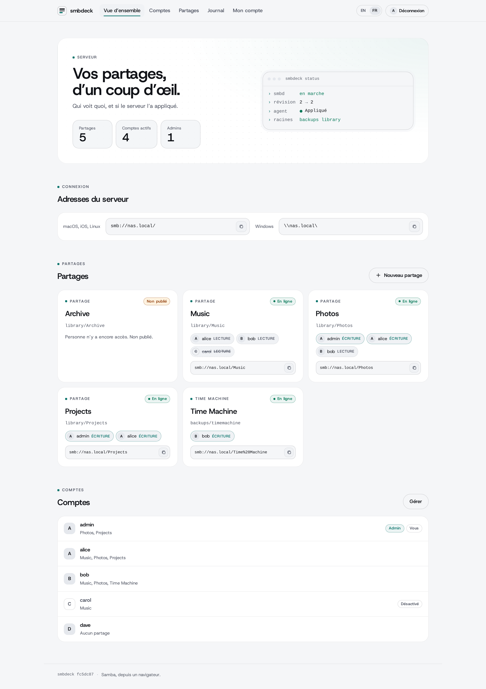

# smbdeck

Une console web petite, sûre et pensée pour les conteneurs, pour administrer
Samba depuis un navigateur : comptes créés à la volée, dossiers partagés,
lecture ou écriture par compte. Pour les homelabs sous Docker Compose ou
Kubernetes.

[English](README.md)



## Pourquoi

Les NAS complets (OpenMediaVault, TrueNAS, Cockpit avec les modules 45Drives,
Webmin) administrent l’hôte sur lequel ils tournent. Les rares consoles Samba
en conteneur tournent le plus souvent en root, souvent avec le socket Docker.
smbdeck comble ce manque : Samba dans un conteneur, une console à côté, et une
frontière nette entre les deux.

- **Trois rôles, une image.** La console ne tourne jamais en root, n’a aucune
  capacité et ne voit jamais vos disques. Seul l’agent touche à Samba.
- **L’agent ne croit rien de ce qu’il lit.** Chaque nom, chemin et valeur est
  revalidé avant d’atteindre `smb.conf` ; les chemins sont résolus sur le
  disque et doivent rester dans leur racine, sans passer par un lien
  symbolique.
- **Les comptes sont des comptes Samba.** Pas de seconde base : on se connecte
  à la console avec ses identifiants SMB. Les administrateurs gèrent tout, les
  autres voient leurs partages et changent leur mot de passe.
- **Les changements s’appliquent en quelques secondes**, et un compte
  désactivé, supprimé, dont le mot de passe change ou dont l’accès passe de
  lecture seule à lecture-écriture perd aussitôt ses sessions SMB ouvertes ;
  le client se reconnecte avec ses nouveaux droits.
- **Un seul fichier JSON à conserver.** La base de comptes de Samba en est
  reconstruite à chaque changement.

## Fonctions

- Comptes : création (mot de passe généré, affiché une seule fois),
  désactivation, réactivation, nouveau mot de passe, droits d’administration,
  suppression. Il reste toujours au moins un administrateur actif.
- Partages : tout dossier sous une racine déclarée, choisi dans
  l’arborescence ou saisi, créé à la demande ; accès par compte (aucun,
  lecture, écriture) ; destinations Time Machine avec taille maximale.
- Adresses de connexion prêtes à copier (`smb://…` et `\\…`).
- État en direct : « application en cours… » devient « appliqué » quand
  l’agent a fini.
- Journal de chaque changement (qui, quoi, quand, d’où), sans secret.
- Annonces sur le réseau local en option : Bonjour/mDNS (Finder, iOS, Linux)
  et WS-Discovery (Réseau de Windows), sans root.
- Anglais et français, clair et sombre, utilisable au clavier, respecte la
  réduction des animations. Aucun framework JavaScript ni CSS, aucune requête
  externe.

## Démarrage avec Docker Compose

L’image est publiée sous `ghcr.io/yeppao-org/smbdeck:0.1.0` (linux/amd64 et
linux/arm64). Lancez l’exemple avec l’adresse de cette machine sur le réseau
local (les ports n’écoutent que sur cette adresse). Rien n’est construit :
Compose tire l’image.

```bash
git clone https://github.com/yeppao-org/smbdeck && cd smbdeck
cd deploy/compose
# Adaptez les racines (vos dossiers) et SMBDECK_ROOTS, puis :
SMBDECK_ADDRESS=192.168.1.50 docker compose up -d
docker compose logs web | grep setupCode
```

Pour lancer une image construite chez vous, construisez-la avec
`docker build -t smbdeck .` et ajoutez `SMBDECK_IMAGE=smbdeck` devant la
commande Compose.

L’image est signée avec cosign (sans clé, depuis le workflow de publication).
Pour vérifier la signature avant de la lancer :

```bash
cosign verify ghcr.io/yeppao-org/smbdeck:0.1.0 \
  --certificate-identity https://github.com/yeppao-org/smbdeck/.github/workflows/release.yml@refs/tags/v0.1.0 \
  --certificate-oidc-issuer https://token.actions.githubusercontent.com
```

La page de la publication donne l’empreinte de l’image et joint la liste des
composants (SBOM, SPDX).

Ouvrez `http://192.168.1.50:8080/setup`, saisissez le code d’installation
écrit dans les journaux, et créez le premier administrateur. Pour atteindre la
console par un nom plutôt qu’une adresse, ajoutez ce nom à
`SMBDECK_ALLOWED_HOSTS`.

L’exemple de [`deploy/compose/`](deploy/compose/docker-compose.yml) est
complet et commenté : privilèges, systèmes de fichiers en lecture seule,
amorçage et annonces en option (`docker compose --profile discovery up -d`).

Pour essayer sans rien toucher de réel (comptes et dossiers fictifs) :

```bash
make image demo   # http://localhost:8080, admin / demo-admin-password
make demo-down
```

## Kubernetes

Le chart Helm est publié sur GHCR comme artefact OCI
(`oci://ghcr.io/yeppao-org/charts/smbdeck`, signé avec cosign comme
l’image) ; sa source est dans
[`deploy/helm/smbdeck/`](deploy/helm/smbdeck/README.md). Il déploie un pod avec l’agent et la console, un PVC pour l’état, vos dossiers en
racines `hostPath`, un Service web, un Service `LoadBalancer` optionnel pour
SMB, et un déploiement optionnel des annonces sur le réseau de l’hôte.
Le chart tire `ghcr.io/yeppao-org/smbdeck` à l’étiquette `0.1.0`. Pour une
image construite chez vous, poussez-la vers un registre que le cluster peut
lire, et indiquez-la dans `image.repository` et `image.tag`.

```bash
helm install smbdeck oci://ghcr.io/yeppao-org/charts/smbdeck --version 0.1.0 \
  --set 'roots[0].name=media' --set 'roots[0].hostPath=/srv/media' \
  --set 'nodeSelector.kubernetes\.io/hostname=nas' \
  --set smb.service.enabled=true
```

Depuis un clone du dépôt, `deploy/helm/smbdeck` à la place de l’adresse
`oci://` et de `--version` installe le même chart.

## Fonctionnement

| Rôle | S’exécute en | Fait | Ne fait jamais |
|---|---|---|---|
| `web` | UID 10001, aucune capacité, racine en lecture seule | sert la console ; écrit l’état voulu (`desired.json`, 0600) dans `/state` ; lit l’état et l’arborescence publiés par l’agent dans `/status`, monté en lecture seule | toucher à Samba ou à un disque : seuls `/state` et `/status` sont montés |
| `agent` | root réduit à `CHOWN FOWNER DAC_OVERRIDE SETUID SETGID NET_BIND_SERVICE`, `no-new-privileges`, racine en lecture seule | lance `smbd` ; relit l’état voulu, le valide strictement, applique ce qui passe et signale le reste par code | exécuter ou écrire une valeur non vérifiée ; sortir d’une racine déclarée |
| `discovery` | avahi en UID 86, wsdd2 en `nobody`, aucune capacité, réseau de l’hôte | annonce `<nom>.local` et `_smb._tcp` (mDNS), et le serveur dans le Réseau de Windows (WS-Discovery, sans LLMNR) | — |

- **Une seule identité pour les fichiers** (`force user`/`force group` =
  `SMBDECK_FILES_UID`/`GID`) : les fichiers restent au propriétaire de
  l’hôte ; l’accès par compte est appliqué par Samba.
- **Les mots de passe** ne sont jamais stockés : seule l’empreinte NT dont
  Samba a besoin l’est (voir [SECURITY.md](SECURITY.md), en anglais).
- **L’état voulu** est un JSON versionné, écrit de façon atomique, avec un
  numéro de révision : deux administrateurs qui modifient en même temps ne
  s’écrasent pas.

## Sécurité

La séparation des rôles protège **l’hôte et l’agent** : la console n’a ni
privilège ni disque, et l’agent, qui a le privilège, ne croit rien de ce
qu’on lui donne ; aucune valeur venue de la console ne peut lui faire exécuter
quoi que ce soit, écrire hors de ses racines ou changer la structure de
`smb.conf`.

Elle ne protège **pas les données des partages** d’une console compromise.
La console décide qui ouvre quoi et détient les empreintes NT, qui valent des
mots de passe en SMB : qui la contrôle peut s’ouvrir tous les partages, ou
s’authentifier sous n’importe quel compte (y compris depuis le pod, sur
`127.0.0.1:445`). Protégez la console et le volume d’état comme les clés des
partages.

La console elle-même a des sessions côté serveur (12 h, 2 h d’inactivité), un
jeton CSRF sur chaque écriture et un contrôle d’origine, des limites de
connexion qu’un tiers ne peut pas transformer en blocage de l’administrateur,
une liste de réseaux autorisés, un contrôle de l’en-tête `Host` (pas de DNS
rebinding), une CSP stricte (aucun script ni style en ligne) et un journal
sans secret. Détails, limites et signalement d’une faille :
[SECURITY.md](SECURITY.md).

## Configuration

Tout passe par des variables d’environnement ; leur liste complète, avec les
valeurs par défaut, est dans le [README anglais](README.md#configuration).
Les plus courantes :

| Variable | Rôle | |
|---|---|---|
| `SMBDECK_ROOTS` | agent | Racines des partages, `nom=/roots/nom,…` |
| `SMBDECK_FILES_UID` / `GID` | agent | Propriétaire des fichiers créés en SMB (1000 par défaut) |
| `SMBDECK_SMB_HOSTS_ALLOW` | agent | Réseaux autorisés à se connecter en SMB |
| `SMBDECK_ALLOWED_NETWORKS` | web | Qui peut ouvrir la console (réseaux privés et 100.64.0.0/10 par défaut) |
| `SMBDECK_TRUSTED_PROXIES` | web | Proxys dont `X-Forwarded-*` est cru ; sans eux, ces en-têtes sont ignorés |
| `SMBDECK_ALLOWED_HOSTS` | web | Noms d’hôte acceptés en plus des adresses et de localhost (421 sinon) |
| `SMBDECK_SMB_HOSTS` | web | Noms affichés dans les adresses de connexion |
| `SMBDECK_SEED_FILE` / `SMBDECK_SEED_PASSWORDS_DIR` | web | Premiers comptes et partages, appliqués une seule fois |
| `SMBDECK_DISCOVERY_HOSTNAME` | discovery | Nom annoncé en `<nom>.local` |
| `SMBDECK_DISCOVERY_INTERFACE` | discovery | Interface de l’hôte sur le réseau local (obligatoire) |

## Développement

Seul Docker est nécessaire : chaque outil tourne dans un conteneur épinglé.
`make test`, `make lint`, `make image`, `make test-integration`, `make demo`,
`make screenshots`, `make helm-lint`. Voir [CONTRIBUTING.md](CONTRIBUTING.md).

## Licence

Apache 2.0, voir [LICENSE](LICENSE). L’image contient aussi
Samba, Avahi, wsdd2 et tini sous leurs propres licences, et la console embarque
la police Host Grotesk (SIL Open Font License) : voir [NOTICE](NOTICE).
