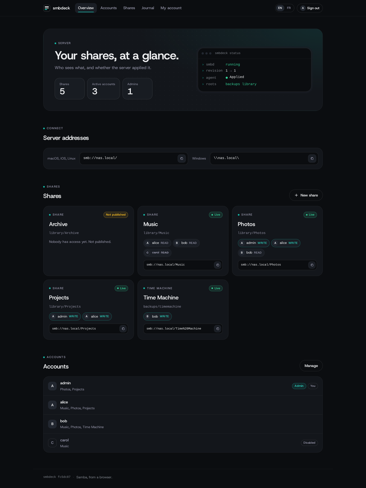
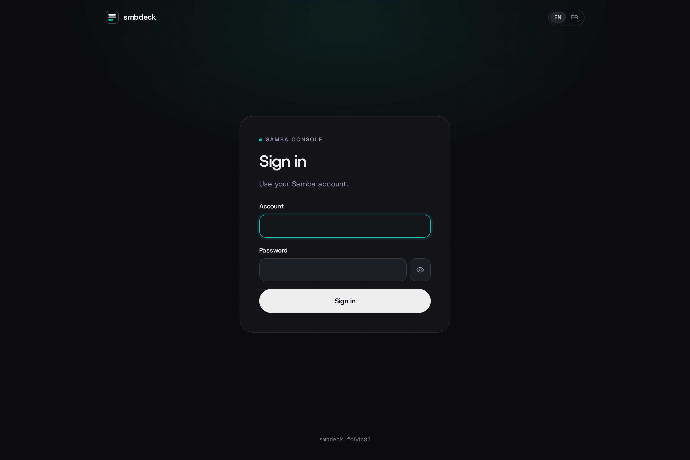
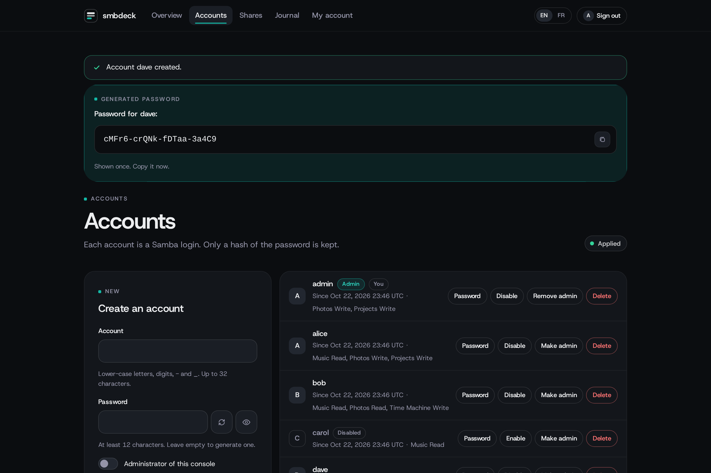
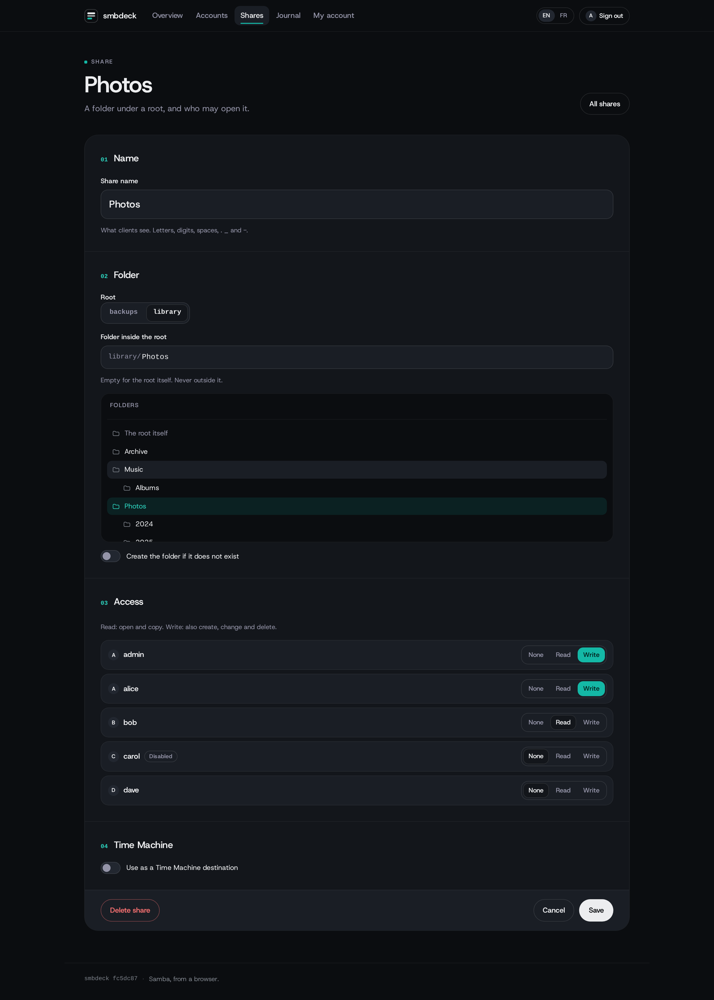
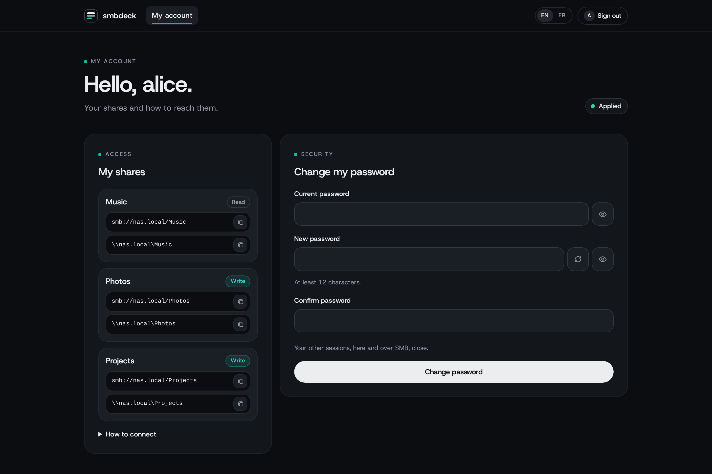
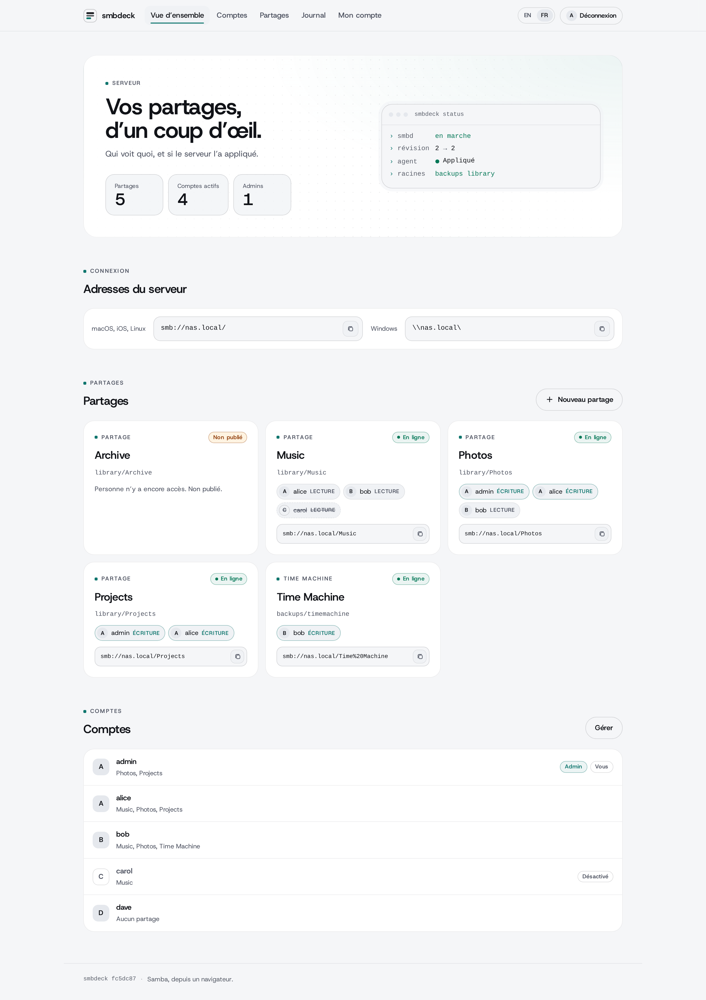
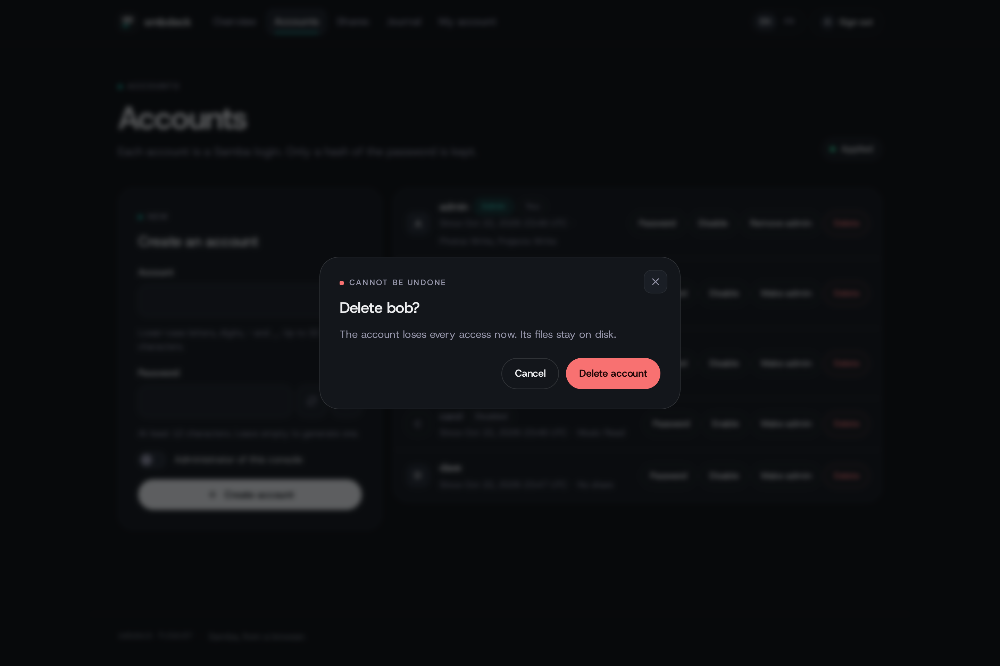

# smbdeck

A small, secure, container-first web console for Samba. Create accounts on the
fly, publish folders, give each account read or write access, from a browser.
Built for homelabs running Docker Compose or Kubernetes.

[Français](README.fr.md)



## Why

Full NAS systems (OpenMediaVault, TrueNAS, Cockpit with the 45Drives plugins,
Webmin) manage the host they run on. The few Samba consoles that run in a
container usually run as root, often with the Docker socket. smbdeck is the
missing piece: Samba in a container, a console next to it, and a strict line
between the two.

- **Three roles, one image.** The console never runs as root, has no
  capability, and never sees your disks. Only the agent touches Samba.
- **The agent trusts nothing it reads.** Every name, path and value is
  validated again before it reaches `smb.conf`; paths are resolved on disk,
  must stay inside their root, and may not go through a symbolic link.
- **Accounts are Samba accounts.** No second user database: sign in to the
  console with your SMB credentials. Administrators manage everything, other
  accounts see their own shares and change their password.
- **Changes apply in seconds**, and an account that is disabled, deleted,
  given a new password or moved from read-only to read-write loses its open
  SMB sessions at once; the client reconnects with the new rights.
- **Nothing to persist but one JSON file.** Samba's account database is
  rebuilt from it at every change.

## Features

- Accounts: create (with a generated password, shown once), disable, enable,
  reset the password, grant or remove administration, delete. At least one
  active administrator always remains.
- Shares: any folder under a declared root, picked from a folder tree or
  typed, created on demand; per-account access (none, read, write); macOS
  Time Machine destinations with an optional size cap.
- Connection addresses ready to copy (`smb://…` and `\\…`).
- Live status: "applying…" turns into "applied" when the agent is done.
- Journal of every change (who, what, when, from where), without secrets.
- Optional LAN discovery: Bonjour/mDNS (Finder, iOS, Linux) and WS-Discovery
  (Windows Network), without root.
- English and French, light and dark, keyboard friendly, respects reduced
  motion. No JavaScript framework, no CSS framework, no external request.

| | |
|---|---|
|  |  |
|  |  |
|  |  |

## Quick start with Docker Compose

The image is published as `ghcr.io/yeppao-org/smbdeck:0.1.0` (linux/amd64 and
linux/arm64). Start the example with this host's address on the local network
(ports are published on that address only). Nothing is built: Compose pulls
the image.

```bash
git clone https://github.com/yeppao-org/smbdeck && cd smbdeck
cd deploy/compose
# Edit the roots (your folders) and SMBDECK_ROOTS, then:
SMBDECK_ADDRESS=192.168.1.50 docker compose up -d
docker compose logs web | grep setupCode
```

To run an image you built yourself, build it with `docker build -t smbdeck .`
and start Compose with `SMBDECK_IMAGE=smbdeck` in front of the command.

The image is signed with cosign (keyless, from the release workflow). To check
the signature before you run it:

```bash
cosign verify ghcr.io/yeppao-org/smbdeck:0.1.0 \
  --certificate-identity https://github.com/yeppao-org/smbdeck/.github/workflows/release.yml@refs/tags/v0.1.0 \
  --certificate-oidc-issuer https://token.actions.githubusercontent.com
```

The release page lists the image digest and carries the SBOM (SPDX).

Open `http://192.168.1.50:8080/setup`, enter the setup code printed in the
logs, and create the first administrator. Then create accounts and shares. To
reach the console by a name rather than an address, add the name to
`SMBDECK_ALLOWED_HOSTS`.

The example in [`deploy/compose/`](deploy/compose/docker-compose.yml) is
complete and commented: privileges, read-only file systems, optional seed and
optional discovery (`docker compose --profile discovery up -d`).

To try it without touching anything real, run the demo (fake accounts and
folders, see [Development](#development)):

```bash
make image demo   # http://localhost:8080, admin / demo-admin-password
make demo-down
```

## Kubernetes

A Helm chart is published to GHCR as an OCI artifact
(`oci://ghcr.io/yeppao-org/charts/smbdeck`, signed with cosign like the
image); its source lives in
[`deploy/helm/smbdeck/`](deploy/helm/smbdeck/README.md). It deploys one pod
with the agent and the console, a PVC for the state, your folders as
`hostPath` roots, a web Service, an optional `LoadBalancer` Service for SMB,
and an optional discovery Deployment on the host network. The chart pulls
`ghcr.io/yeppao-org/smbdeck` at the tag `0.1.0`. To use an image you built,
push it to a registry your cluster can pull from, and set `image.repository`
and `image.tag`.

```bash
helm install smbdeck oci://ghcr.io/yeppao-org/charts/smbdeck --version 0.1.0 \
  --set 'roots[0].name=media' --set 'roots[0].hostPath=/srv/media' \
  --set 'nodeSelector.kubernetes\.io/hostname=nas' \
  --set smb.service.enabled=true
kubectl logs deploy/smbdeck -c web | grep setupCode
```

From a clone of this repository, `deploy/helm/smbdeck` in place of the
`oci://` address and `--version` installs the same chart.

A `hostPath` root exists on one node only: `nodeSelector` pins the pod to the
node that holds the folder (here, the node named `nas`).

## How it works

```
             browser                                  SMB clients
                │ HTTP(S)                                  │ TCP 445
     ┌──────────▼───────────┐                  ┌───────────▼────────────┐
     │ web (UID 10001)      │  /state (rw)  →  │ agent (reduced root)   │
     │ no capability        │  desired.json    │ runs and watches smbd  │
     │ read-only root fs    │                  │ validates everything   │
     │ no disk mounted      │  ← /status (ro)  │ /roots/<name> mounted  │
     └──────────────────────┘  status, tree    └────────────────────────┘
                                                  discovery (optional, host
                                                  network): avahi as 86,
                                                  wsdd2 as nobody
```

| Role | Runs as | Does | Never does |
|---|---|---|---|
| `web` | UID 10001, no capability, read-only root fs | serves the console; writes the desired state (`desired.json`, 0600) in `/state`; reads the agent's status and folder tree from `/status`, mounted read-only | touch Samba or any disk: only `/state` and `/status` are mounted |
| `agent` | root reduced to `CHOWN FOWNER DAC_OVERRIDE SETUID SETGID NET_BIND_SERVICE`, `no-new-privileges`, read-only root fs | runs `smbd`; reads the desired state (no link, no FIFO, 1 MiB at most), validates it strictly, applies what passes; reports the rest by code in `/status` | write in `/state`; run or write a value it has not checked; leave a declared root |
| `discovery` | avahi as UID 86, wsdd2 as `nobody`, no capability, host network | announces `<name>.local` and `_smb._tcp` (mDNS), and the server in the Windows Network (WS-Discovery, LLMNR off) | — |

- **One identity for files.** Every file operation goes through a single Unix
  identity (`force user` / `force group` = `SMBDECK_FILES_UID` /
  `SMBDECK_FILES_GID`): files keep belonging to their owner on the host, and
  access per account is enforced by Samba (`valid users`, `read list`,
  `write list`).
- **Accounts** are Unix accounts of the agent container (no shell, no home)
  with a stable UID from 20000, and entries in an `smbpasswd` file that the
  agent rewrites atomically from the state. Samba reads it on every
  authentication, so a change takes effect without a restart.
- **Passwords** are never stored: only the NT hash Samba needs (see
  [SECURITY.md](SECURITY.md)).
- **The desired state** is versioned JSON, written atomically (temporary file,
  fsync, rename) with a revision number; two administrators editing at once
  cannot overwrite each other (the second gets "the configuration changed
  meanwhile").
- **Generated `smb.conf`**: SMB 2.1 minimum, encryption offered, no guest, no
  anonymous listing, no NetBIOS, no printing, `wide links = no`, each account
  only sees the shares it may open (`access based share enum`), macOS
  compatibility (`fruit`). A share nobody may open is not published at all.

## Security model

The separation of roles protects the **host and the agent**: the console holds
no privilege and mounts no disk, and the agent, which holds the privilege,
believes nothing it is given, so no value from the console can make it run
something, write outside its roots, or rewrite the structure of `smb.conf`.

It does **not** protect the **data on the shares** from a compromised console.
The console decides who may open what, and it holds the NT hashes, which are
as good as passwords for SMB: whoever controls it can grant itself access to
every share, or authenticate as any account (including from inside the pod,
to `127.0.0.1:445`). Treat the console, and the state volume, as you would the
keys to the shares.

The console itself has server-side sessions (12 h, 2 h idle), a CSRF token on
every write plus a cross-origin check, sign-in limits that a third party
cannot turn into a lockout of the administrator, a list of allowed networks,
a check of the `Host` header (no DNS rebinding), a strict Content Security
Policy (no inline script or style), and a journal without secrets. Details,
limits and how to report a vulnerability: [SECURITY.md](SECURITY.md).

## Configuration

Every setting is an environment variable. A bad value stops the role at start
with a clear message, rather than running with a guess.

### Agent

| Variable | Default | |
|---|---|---|
| `SMBDECK_ROOTS` | none | Share roots, `name=/roots/name,…`. Each directory must be under `/roots/`; roots may not overlap. |
| `SMBDECK_FILES_UID` / `SMBDECK_FILES_GID` | `1000` / `1000` | Owner of every file created over SMB. Never 0; the UID is never 20000–59999 (accounts). |
| `SMBDECK_SMB_NETBIOS_NAME` | `SMBDECK` | Server name, 15 characters at most. |
| `SMBDECK_SMB_SERVER_STRING` | `smbdeck` | Description shown by some clients. |
| `SMBDECK_SMB_WORKGROUP` | `WORKGROUP` | |
| `SMBDECK_SMB_HOSTS_ALLOW` | any | Networks allowed to connect to SMB at all (CIDR list). |
| `SMBDECK_SMB_LOG_LEVEL` | `1` | Samba's log level, 0 to 10. |
| `SMBDECK_SMB_SIGNING` | `mandatory` | SMB signing, `mandatory` or `auto` (for very old clients). |
| `SMBDECK_STATUS_DIR` | `/status` | Where the agent writes `status.json`, `tree.json` and a copy of the last applied state. Must differ from `/state`; the console mounts it read-only. |
| `SMBDECK_RUN_DIR` | `/run/smbdeck` | A tmpfs: generated accounts, `smbpasswd`, `smb.conf`, Samba's runtime files. |
| `SMBDECK_POLL_INTERVAL` | `1s` | How often the desired state is checked for changes. |
| `SMBDECK_RESYNC_INTERVAL` | `1m` | Full re-validation of every path (links can change on disk). |
| `SMBDECK_TREE_INTERVAL` | `10m` | Refresh of the folder tree shown by the picker (also after the agent creates a folder). |

### Web

| Variable | Default | |
|---|---|---|
| `SMBDECK_LISTEN` | `:8080` | |
| `SMBDECK_ALLOWED_NETWORKS` | private ranges | Who may open the console at all: `127.0.0.0/8, 10.0.0.0/8, 172.16.0.0/12, 192.168.0.0/16, 100.64.0.0/10, ::1, fc00::/7, fe80::/10` by default. |
| `SMBDECK_TRUSTED_PROXIES` | none | Reverse proxies whose `X-Forwarded-For` and `X-Forwarded-Proto` are believed. Without it, those headers are ignored; a hop that cannot be read refuses the request. |
| `SMBDECK_ALLOWED_HOSTS` | none | Host names the console answers to, besides IP addresses and `localhost`. Any other `Host` gets 421 (DNS rebinding). |
| `SMBDECK_STATUS_DIR` | `/status` | The agent's reports, mounted read-only. |
| `SMBDECK_COOKIE_SECURE` | `auto` | `auto` (Secure over HTTPS), `always`, `never`. |
| `SMBDECK_TLS_CERT` / `SMBDECK_TLS_KEY` | none | Serve HTTPS directly. |
| `SMBDECK_PASSWORD_MIN_LENGTH` | `12` | 8 to 128. |
| `SMBDECK_SESSION_LIFETIME` / `SMBDECK_SESSION_IDLE` | `12h` / `2h` | |
| `SMBDECK_SMB_HOSTS` | the host in the browser | Names or addresses shown in connection strings, comma-separated. |
| `SMBDECK_SEED_FILE` / `SMBDECK_SEED_PASSWORDS_DIR` | none | First accounts and shares, see below. |
| `SMBDECK_AUDIT_MAX_KB` | `1024` | The journal rotates once (`audit.log.1`) past this size; 16 to 16384. |
| `TZ` | `UTC` | Time zone of the times shown, for example `Europe/Paris`. |

### Discovery

| Variable | Default | |
|---|---|---|
| `SMBDECK_DISCOVERY_HOSTNAME` | required | Announced as `<name>.local`. |
| `SMBDECK_DISCOVERY_ADDRESS` | this host | IPv4 address `<name>.local` points to (a load balancer IP, for example). Empty: this host's own addresses. |
| `SMBDECK_DISCOVERY_INTERFACE` | required | The host's interface on the local network: on the host network, avahi and wsdd2 would otherwise answer on every interface. |
| `SMBDECK_DISCOVERY_NAME` | the host name | Bonjour service name. |
| `SMBDECK_DISCOVERY_TIMEMACHINE_SHARES` | none | Shares advertised as Time Machine destinations. |
| `SMBDECK_DISCOVERY_WORKGROUP` / `SMBDECK_DISCOVERY_MODEL` | `WORKGROUP` / `Xserve` | |
| `SMBDECK_DISCOVERY_RUN_DIR` | `/run/smbdeck-discovery` | A tmpfs writable by UID 86: avahi's configuration and runtime directory. |

Run `smbdeck discovery mdns` as UID 86 with a writable
`/run/smbdeck-discovery`, and `smbdeck discovery wsd` as `nobody`, both on the
host network (multicast does not cross networks). In the image, tini is PID 1:
wsdd2 must not be PID 1 on the host network, where its netlink socket would
collide with systemd's (`bind: Address in use`). If you replace the entry
point, keep an init as PID 1, or use `pid: host` (Compose) /
`shareProcessNamespace: true` (Kubernetes).

All roles also read `SMBDECK_STATE_DIR` (`/state`), `SMBDECK_LOG_LEVEL`
(`info`) and `SMBDECK_LOG_FORMAT` (`text` or `json`). `smbdeck healthcheck`
(the image's `HEALTHCHECK`) finds the role from the command line of PID 1, or
from `SMBDECK_ROLE` (`web`, `agent` or `discovery`) when the entry point is
replaced. For the agent it checks that smbd answers and that `status.json` was
refreshed in the last three minutes; for the console, `/healthz` where
`SMBDECK_LISTEN` points.

### Seeding the first accounts

Without any state, the console offers to create the first administrator once,
with a setup code printed in its logs. To provision from files instead (GitOps,
or carrying an existing password over):

```json
{
  "users": [{ "name": "admin", "admin": true }, { "name": "alice" }],
  "shares": [{ "name": "Media", "root": "media", "path": "", "access": { "admin": "rw", "alice": "ro" } }]
}
```

`SMBDECK_SEED_FILE` points to that file, and `SMBDECK_SEED_PASSWORDS_DIR` to a
directory with one file per account holding its initial password (a mounted
Kubernetes Secret works). Passwords are hashed and never stored. The seed is
applied only when no desired state exists; afterwards it is ignored.

## Development

Only Docker is needed: every tool runs in a pinned container.

```bash
make test               # unit tests, race detector
make lint               # golangci-lint
make image              # build smbdeck:dev
make test-integration   # real Samba in Docker, driven through the console
make demo               # local demo with fake data
make screenshots        # README screenshots (headless Chromium)
make helm-lint          # lint and render the Helm chart
```

See [CONTRIBUTING.md](CONTRIBUTING.md).

## License

Apache License 2.0, see [LICENSE](LICENSE). The image also ships
Samba, Avahi, wsdd2 and tini under their own licenses; the console embeds the
Host Grotesk font (SIL Open Font License). See [NOTICE](NOTICE).
